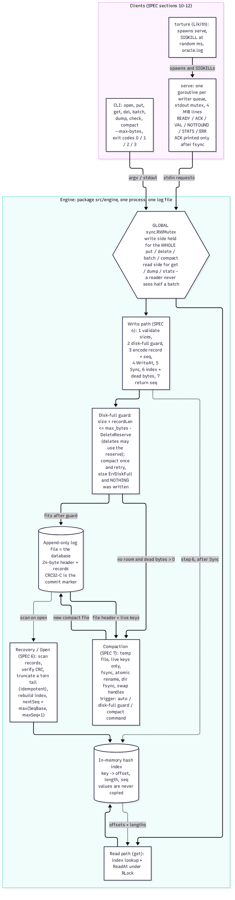

# Architecture

Owner: **Anirudh** (PR A6). Everything here must match the code; the judge spot-checks three rows.

## Part 1: Diagram

Visual reference: team Miro board, https://miro.com/app/board/uXjVERbFfok=/

TODO(Anirudh): the diagram must show every component (client API, write path, in-memory index, log writer, commit-marker logic, recovery routine, compaction routine, disk-full guard), the file layout with field sizes, the numbered write order, the recovery flow, and the locks.

## Part 2: Proof table

| ID | Scenario | Disk state at the moment of the kill | Mechanism that handles it | Where in the code (file and function) | Verified by |
|---|---|---|---|---|---|
| A1 | Kill before any bytes of a put reach the file | TODO | TODO | TODO | TODO |
| A2 | Kill after some bytes of the record are written (torn write) | TODO | TODO | TODO | TODO |
| A3 | Kill after the record is fully written but before fsync | TODO | TODO | TODO | TODO |
| A4 | Kill after fsync returns but before put returns | TODO | TODO | TODO | TODO |
| A5 | Kill immediately after put returns success | TODO | TODO | TODO | TODO |
| A6 | Kill during a delete | TODO | TODO | TODO | TODO |
| A7 | Kill during a put of a 1 MB value | TODO | TODO | TODO | TODO |
| B1 | Kill after 3 of 10 operations are written | TODO | TODO | TODO | TODO |
| B2 | Kill after all 10 are written but the commit marker is not | TODO | TODO | TODO | TODO |
| B3 | Kill after the commit marker is written but before fsync | TODO | TODO | TODO | TODO |
| B4 | Kill after the batch returns success | TODO | TODO | TODO | TODO |
| B5 | A batch that puts key X and deletes key X | TODO | TODO | TODO | TODO |
| B6 | A batch of 10,000 operations killed halfway | TODO | TODO | TODO | TODO |
| C1 | Kill during open() while it replays the log | TODO | TODO | TODO | TODO |
| C2 | Kill during open() while it truncates or repairs a torn tail | TODO | TODO | TODO | TODO |
| C3 | Kill during compaction, before the new file replaces the old | TODO | TODO | TODO | TODO |
| C4 | Kill during compaction, in the middle of the rename or swap | TODO | TODO | TODO | TODO |
| C5 | Kill after the swap, before temp files are cleaned up | TODO | TODO | TODO | TODO |
| C6 | Kill during close() | TODO | TODO | TODO | TODO |
| D1 | Two writers putting different keys, killed at random | TODO | TODO | TODO | TODO |
| D2 | Two writers putting the same key, killed at random | TODO | TODO | TODO | TODO |
| D3 | One writer in a long batch, another doing single puts | TODO | TODO | TODO | TODO |
| D4 | A reader calling get during a batch on the same keys (no crash) | TODO | TODO | TODO | TODO |
| E1 | Cap reached during a single put | TODO | TODO | TODO | TODO |
| E2 | Cap reached halfway through a batch | TODO | TODO | TODO | TODO |
| E3 | Cap reached, then process killed | TODO | TODO | TODO | TODO |
| E4 | Cap reached during compaction | TODO | TODO | TODO | TODO |
| E5 | Deletes free space, compaction runs, writes work again | TODO | TODO | TODO | TODO |
| F1 | 500 consecutive random kills and restarts | TODO | TODO | TODO | TODO |
| F2 | Kill, restart, kill during recovery, restart, kill during recovery again | TODO | TODO | TODO | TODO |
| F3 | 1,000,000 keys written, process killed, open() called | TODO | TODO | TODO | TODO |
| F4 | Database file truncated by 1 byte at the end by hand | TODO | TODO | TODO | TODO |

## Part 3: The three guarantees

### Durability

TODO(Anirudh): name the syscalls and the ordering it depends on.

### Atomicity

TODO(Anirudh): name the syscalls and the ordering it depends on.

### Recoverability

TODO(Anirudh): name the syscalls and the ordering it depends on.
