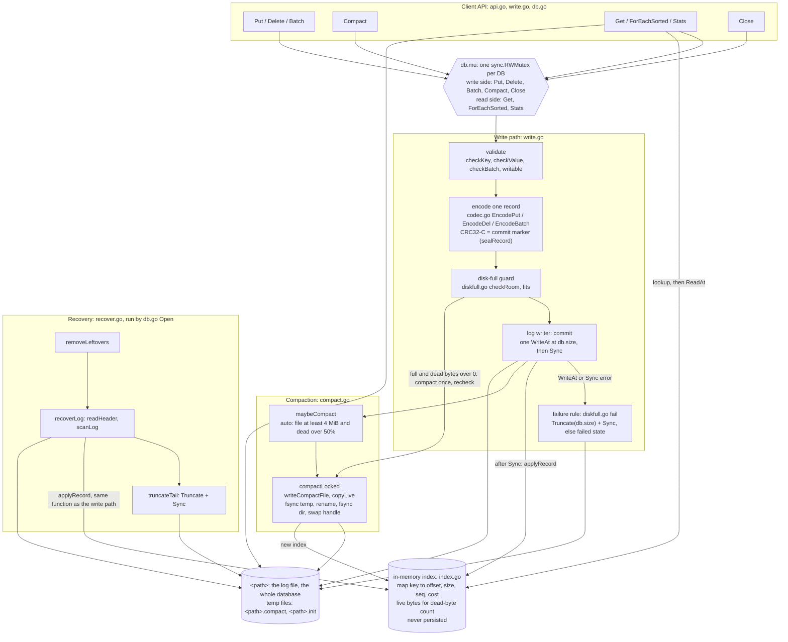
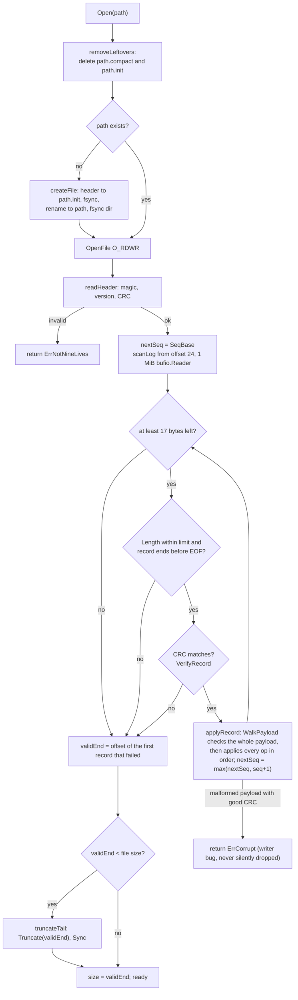

# Architecture

Owner: **Anirudh** (PR A6). Everything here must match the code; the judge spot-checks three rows. Code references name a file under `src/engine/` and a function, not line numbers, so they stay correct when lines move. Test names refer to `tests/engine/`.

## Part 1: Diagram

Visual reference: team Miro board, https://miro.com/app/board/uXjVERbFfok=/


The exported picture comes from `diagrams/` (Khushi, PR K4). The Mermaid diagrams and the layout below are written against the code in this file and render on GitHub.

### 1.1 Components and locks



**Locks.** There is one lock, `DB.mu` (`db.go`). A writer holds the write side for the whole sequence of validate, guard, WriteAt, Sync, index update and any auto-compaction, so writes are serialised and a record is never interleaved with another. Readers take the read side, so they see the index either before or after a whole record (a whole batch) is applied. Recovery runs inside `Open`, before the `*DB` is returned to anyone, so it needs no lock. `serve` (Khushi, PR K2) adds its own stdout mutex; that is outside the engine.

### 1.2 File layout

All integers little-endian. The index is not stored in the file; it lives only in memory and is rebuilt by every `Open`.

```
File header, 24 bytes, written only by createFile (create.go) and compaction (copyLive):
  0        4        6        8                16       20       24
  +--------+--------+--------+----------------+--------+--------+
  | "NLV1" | ver=1  | flags=0| SeqBase        | rsvd=0 | CRC32-C|
  | 4 B    | 2 B    | 2 B    | 8 B            | 4 B    | 4 B    |  CRC over bytes 0-19
  +--------+--------+--------+----------------+--------+--------+

Record, repeated to end of file (17-byte header + payload):
  0        4        8     9                17
  +--------+--------+-----+----------------+---------------------+
  | CRC32-C| Length | Type| Seq            | Payload (Length B)  |
  | 4 B    | 4 B    | 1 B | 8 B            |                     |
  +--------+--------+-----+----------------+---------------------+
  CRC covers bytes 4 .. end of payload (Length, Type, Seq, Payload).
  The CRC is the commit marker: a record exists only if all Length bytes
  are present and the CRC matches.

Payloads (Type):
  0x01 PUT    key_len u16 | key | val_len u32 | value
  0x02 DEL    key_len u16 | key
  0x03 BATCH  count u32 | count x ( op u8 (1 put, 2 del) | key_len u16 | key | [val_len u32 | value] )

Next to the file (never authoritative, deleted by Open):
  <path>.init     new file being created (create.go createFile)
  <path>.compact  compaction output before the rename (compact.go writeCompactFile)
```

Limits (`api.go`): key 1 to 1024 bytes, value up to 1 MiB, batch up to 10,000 ops and 64 MiB of keys plus values.

### 1.3 Write order (numbered)

`Put`, `Delete` and `Batch` in `write.go`. Steps 1 to 10 all run with `db.mu` held.

1. `db.mu.Lock()`.
2. Validate: `checkKey`, `checkValue`, `checkBatch`; then `writable` (returns `ErrClosed` or `ErrFailed`). An empty batch returns seq 0 here and writes nothing.
3. Encode the whole record into one buffer with `seq = db.nextSeq` (`EncodePut`, `EncodeDel`, `EncodeBatch`). `sealRecord` computes the CRC last, in memory. This touches no disk.
4. Disk-full guard, `checkRoom` (`diskfull.go`): put and batch need `size + len(rec) <= MaxBytes - DeleteReserve`, delete needs `size + len(rec) <= MaxBytes`. If it does not fit and there are dead bytes, compact once and check again; else return `ErrDiskFull`. Nothing has been written.
5. `db.f.WriteAt(rec, db.size)`: one call, appending at the end of the last committed record.
6. `db.f.Sync()` (fsync).
7. `applyRecord`: update the index and `nextSeq`.
8. `db.size += len(rec)`.
9. `maybeCompact`: automatic compaction if the file is at least 4 MiB and more than half of it is dead. Its error is dropped, because the write is already durable.
10. Return `seq`; the deferred `Unlock` releases the lock.
11. `serve` prints `ACK <opid> <seq>` only after step 10 returned no error.

Failure rule: if step 5 or 6 fails, `fail` truncates the file back to `db.size` and fsyncs, so the write never happened (ENOSPC and EFBIG become `ErrDiskFull`). If that also fails, `db.failed` is set and every later write returns `ErrFailed` until reopen.

SPEC section 4 lists the guard before encoding. The code encodes first because the guard needs the exact record length. Encoding touches no disk, so the order of disk effects is the same.

### 1.4 Recovery flow (`Open`, `db.go` and `recover.go`)



## Part 2: Proof table

"Page cache" below means data written by `WriteAt` but not yet fsynced. A SIGKILL does not lose it (only power loss could), so after a kill the next `open()` reads it.

`TestCrashPoints/<name>/<N>` runs a child process with `NINELIVES_CRASH_AT=<name>` and `NINELIVES_CRASH_AFTER=<N>`, so the child SIGKILLs itself at that point. The parent then reopens the file and checks: every acked step is present; the killed step is absent, present, or either, as listed in the test; and `Check` prints OK. The child starts from a file that already has a torn tail. Run them with `go test ./tests/engine -run TestCrashPoints -v`.

| ID | Scenario | Disk state at the moment of the kill | Mechanism that handles it | Where in the code (file and function) | Verified by |
|---|---|---|---|---|---|
| A1 | Kill before any bytes of a put reach the file | No byte of the new record. The file ends at `db.size`, the end of the last committed record. | Nothing to repair. The scan ends at the old end, so the key keeps its previous value or stays absent. The put was never acked. | `write.go` `commit` (crash point `before_write`); `recover.go` `scanLog` | `TestCrashPoints/before_write/` (killed op must be absent) |
| A2 | Kill after some bytes of the record are written (torn write) | A prefix of the record after `db.size`: a short header, a Length that runs past EOF, or a short payload. | The CRC is the commit marker. `scanLog` stops at the first record that is short or fails `VerifyRecord`, and `truncateTail` cuts the file there and fsyncs. Torn bytes never reach the index, so they are never returned. | `recover.go` `scanLog`, `truncateTail`; `codec.go` `DecodeRecordHeader`, `VerifyRecord` | `TestCrashPoints/mid_write/` (half the record written, then SIGKILL; op must be absent); `TestRecoveryTruncatesTornTail` (every prefix, 0 to len-1 bytes) |
| A3 | Kill after the record is fully written but before fsync | The whole record is in the page cache, not fsynced. | Either outcome is allowed. A complete record with a good CRC is applied (the op was in flight, never acked). We only ever append at `db.size`, so earlier records are untouched. | `write.go` `commit` (between `WriteAt` and `Sync`, crash point `after_write`) | `TestCrashPoints/after_write/` |
| A4 | Kill after fsync returns but before put returns | The record is complete and durable. The index may or may not be updated (memory only). No ACK yet. | The scan finds the complete record and `applyRecord` applies it, so the key has the new value. | `write.go` `commit` (crash points `after_fsync`, `after_index`); `recover.go` `applyRecord` | `TestCrashPoints/after_fsync/` and `/after_index/` (killed op must be present) |
| A5 | Kill immediately after put returns success | The record was fsynced before `Put` returned. | `commit` returns only after `Sync` succeeded, and `serve` ACKs only after that return. Recovery replays every committed record. | `write.go` `commit`; `recover.go` `scanLog`, `applyRecord` | Every `TestCrashPoints` case checks that all acked steps are present (for example `after_fsync/3` dies in step 2 after 2 acks); `TestE3ReopenAfterCapKeepsAckedData` reopens without `Close` |
| A6 | Kill during a delete | Same states as A1 to A4, for one DEL record (17-byte header plus key). | A DEL is one record with its own CRC. A committed DEL removes the key in `applyRecord`; a torn DEL is truncated and the key keeps its old value. | `write.go` `Delete`, `commit`; `recover.go` `applyRecord` | `TestCrashPoints/after_fsync/3` (dies in the delete step after fsync; the key must be gone). A torn DEL is not tested on its own; it takes the same path as A2 |
| A7 | Kill during a put of a 1 MB value | Same as A1 to A4 with a record of about 1 MiB. The kernel can stop a large write part way when SIGKILL arrives, which leaves a prefix. | Same as A1 to A5: one `WriteAt`, one CRC. `scanLog` accepts any Length up to `MaxRecordPayload` and grows its buffer. | `write.go` `commit`; `recover.go` `scanLog` | `TestLargeAndEmptyValues` (a 1 MiB value survives reopen, no kill). A kill during a 1 MiB put: not verified yet (torture `large-values`, PR L3) |
| B1 | Kill after 3 of 10 operations are written | A prefix of the single BATCH record. | A batch is one record with one CRC over all its ops. A prefix fails the length or CRC check, so it is truncated and none of the ops are visible. | `codec.go` `EncodeBatch`, `VerifyRecord`; `recover.go` `scanLog`, `truncateTail` | `TestCrashPoints/batch_mid_write/` (half of a 3-op batch; must be absent); `TestRecoveryTruncatesTornTail` (every prefix of a 2-op batch) |
| B2 | Kill after all 10 are written but the commit marker is not | There is no separate trailing marker: the commit marker is the CRC in the record's first 4 bytes, computed in memory by `sealRecord` before the single `WriteAt`. "Ops written, marker not" therefore means a record that is short or whose CRC does not match. | The record does not count as committed. `scanLog` stops there, `truncateTail` cuts it, none visible. | `codec.go` `sealRecord`, `VerifyRecord`; `recover.go` `scanLog` | `TestRecoveryTruncatesTornTail` (prefix of len-1 bytes: every op byte but the last); `TestRecoveryStopsAtBadCRC` (full length, wrong CRC: dropped and cut) |
| B3 | Kill after the commit marker is written but before fsync | The whole batch record is in the page cache, not fsynced. | All or none. A complete record with a good CRC goes to `applyRecord`, and `WalkPayload` checks the whole payload before applying any op, so it applies all ops or none. Anything less is torn: none. | `recover.go` `applyRecord`; `codec.go` `WalkPayload` | `TestCrashPoints/after_write/2` (dies after the batch's `WriteAt`, before `Sync`); `TestMalformedPayloadIsCorruptAndAppliesNothing` |
| B4 | Kill after the batch returns success | The batch record was fsynced before `Batch` returned. | Same as A5: the scan applies every op of the committed record. | `write.go` `Batch`, `commit`; `recover.go` `applyRecord` | `TestCrashPoints` cases that die after step 1 (the batch) was acked, for example `after_fsync/3` and all `compact_*` cases: the batch's keys `k2` and `k3` must be present (`k1` is deleted by the next step) |
| B5 | A batch that puts key X and deletes key X | One BATCH record listing `put X`, then `del X`. | Ops apply in listed order, in the write path and in recovery alike (both use `applyRecord`), so the last op on a key wins: X is absent. The rule is in SPEC section 3. | `codec.go` `WalkPayload`; `recover.go` `applyRecord` | `TestBatchOrderAndSingleSeq` (`put x; del x` leaves x absent, before and after reopen); `TestBatchRoundTripKeepsOrder` |
| B6 | A batch of 10,000 operations killed halfway | A prefix of one large BATCH record (up to 64 MiB of keys and values). | Same as B1. The scan reads through a 1 MiB `bufio.Reader` and stops at the torn record. | `recover.go` `scanLog`, `truncateTail` | Same code path as B1, tested with small batches only. A 10,000-op batch killed halfway: not verified yet (torture `large-batch`, PR L3) |
| C1 | Kill during open() while it replays the log | The file is unchanged: the scan only reads, and the index is only in memory. | A kill loses only the in-memory index. The next `open()` scans the same bytes and builds the same index. | `recover.go` `recoverLog` (crash point `recovery_mid_scan`), `scanLog` | `TestCrashPoints/recovery_mid_scan/` and `/recovery_mid_scan/2` |
| C2 | Kill during open() while it truncates or repairs a torn tail | Before `Truncate`: the torn tail is still there. After `Truncate`, before `Sync`: the cut is done but may not be durable. | Truncating to `validEnd` is idempotent. The next `open()` stops at the same `validEnd` and truncates again, or finds a clean end. | `recover.go` `truncateTail` (crash points `recovery_before_truncate`, `recovery_after_truncate`) | `TestCrashPoints/recovery_before_truncate/` and `/recovery_after_truncate/` |
| C3 | Kill during compaction, before the new file replaces the old | `<path>` is untouched. `<path>.compact` is partial, or complete and fsynced. | The old file is authoritative until the rename. `Open` calls `removeLeftovers`, which deletes `<path>.compact` before reading `<path>`. | `compact.go` `writeCompactFile`, `copyLive`, `compactLocked`; `recover.go` `removeLeftovers` | `TestCrashPoints/compact_mid_temp/` and `/compact_after_temp_fsync/`; `TestOpenIgnoresCompleteTempFile` |
| C4 | Kill during compaction, in the middle of the rename or swap | `rename(2)` is atomic, so `<path>` names either the old file or the new one. | The temp file is fsynced before the rename, so whichever file `<path>` names is complete, and both hold the same live data with the same seqs. The handle swap is memory only. | `compact.go` `compactLocked` (crash point `compact_after_rename`) | `TestCrashPoints/compact_after_rename/`. A kill inside the rename syscall cannot be aimed at from user space; we rely on rename being atomic on Linux and macOS |
| C5 | Kill after the swap, before temp files are cleaned up | The rename moved `<path>.compact` to `<path>`, so no compaction temp file is left. The directory fsync may or may not have run. | Nothing to clean up after a successful rename. Any `<path>.compact` or `<path>.init` from an earlier kill is deleted by the next `Open` and is never read. `Check` reports a leftover temp file as `CORRUPT`. | `recover.go` `removeLeftovers`, `Check`; `fsutil.go` `compactPath`, `initPath` | `TestCrashPoints/compact_after_dir_fsync/`; `TestOpenRemovesLeftoverTempFiles`; `TestCheckReportsLeftoverTempFile` |
| C6 | Kill during close() | Every acked write is already fsynced. `Close` only closes the file descriptor and writes nothing. | Nothing to flush, so a kill in `Close` is the same as a kill after the last ack (A5). | `db.go` `Close` | Not verified: no crash point or test kills inside `Close`. Argument only |
| D1 | Two writers putting different keys, killed at random | Whole records from both writers in lock order. At most one record is being written at any moment, so only the last one can be torn. | The write lock covers write, fsync and index update, so records never interleave. Each record gets a unique seq. Recovery handles the tail as A1 to A4. | `db.go` `DB.mu`; `write.go` `Put`, `commit` | `TestConcurrentWriters` (8 writers, no kill: every acked put is present after reopen and all seqs are unique; also run with `-race`). With random kills: not verified yet (torture, PRs L1, L2) |
| D2 | Two writers putting the same key, killed at random | Several PUT records for the key, each value inside its own CRC-checked record. | The index entry points at exactly one record's value (offset and length). The record latest in the file wins. Values are never merged. | `index.go` `put`; `recover.go` `applyRecord` | Not verified yet: no test writes one key from two goroutines (torture, PRs L1, L2) |
| D3 | One writer in a long batch, another doing single puts | Whole BATCH and PUT records in lock order. | The batch is one record written under the same lock as the puts, so each put lands before or after it, never inside. Atomicity as in B1 to B4. | `write.go` `Batch`, `Put`, `commit` | Not verified yet (torture, PR L3) |
| D4 | A reader calling get during a batch on the same keys (no crash) | No crash. | `Batch` holds the write lock from validation through the index update. `Get` takes the read lock, so it sees the index before or after the whole batch. | `db.go` `Get`; `write.go` `Batch`, `commit` | Not verified: no test reads during a batch. `TestConcurrentWriters` (puts and gets) passes under `-race` |
| E1 | Cap reached during a single put | Nothing written: the guard runs before `WriteAt`. A real ENOSPC or EFBIG during `WriteAt` leaves a partial record, which `fail` cuts off. | `checkRoom` refuses with `ErrDiskFull` before any byte is written. `fail` truncates to `db.size` and fsyncs, so the DB stays readable and usable. | `diskfull.go` `checkRoom`, `fits`, `fail`, `writeError` | `TestE1PutAtCapFailsCleanly`; `TestFailedWriteIsTruncatedAndDBStaysUsable` (a real partial write through `RLIMIT_FSIZE`) |
| E2 | Cap reached halfway through a batch | Nothing written: the guard checks the length of the whole batch record before `WriteAt`. | A batch is one record and gets one guard check, so the cap cannot hit halfway. If the OS runs out of space mid-write, `fail` cuts the partial bytes. | `diskfull.go` `checkRoom`, `fail`; `write.go` `commit` | `TestE2BatchOverCapAppliesNothing` |
| E3 | Cap reached, then process killed | Every acked record is fsynced. Refused writes left nothing. A kill inside `fail` before its `Truncate` can leave a partial, never-acked record at the tail. | Recovery treats that tail as in A2. | `diskfull.go` `fail`; `recover.go` `scanLog`, `truncateTail` | `TestE3ReopenAfterCapKeepsAckedData` (reopen without `Close`) |
| E4 | Cap reached during compaction | `<path>` is untouched; `<path>.compact` is partial. | `copyLive` checks each record against `MaxBytes`. Over it, it returns `ErrDiskFull`, `compactLocked` removes the temp file, and the old file and index stay in use. A kill here is C3. | `compact.go` `copyLive`, `compactLocked` | `TestE4CompactionOverCapFailsCleanly` |
| E5 | Deletes free space, compaction runs, writes work again | Dead bytes from deletes and overwrites. | `DeleteReserve` (64 KiB) keeps room for deletes when puts are refused. When a record does not fit and there are dead bytes, `checkRoom` compacts once and rechecks, so writes work again with no manual step. Auto-compaction (`maybeCompact`) also runs after writes. | `diskfull.go` `checkRoom`; `compact.go` `compactLocked`, `maybeCompact` | `TestE5DeletesThenCompactionFreesSpace`; `TestDeletesUseReserve` |
| F1 | 500 consecutive random kills and restarts | Any of the states above. | All of the mechanisms above. Recovery is deterministic: same bytes, same index. | Everything above | Not verified yet: needs `torture --iterations 500` (PRs L1 to L4). `TestCrashPoints` runs 16 fixed cases over the 13 crash points, not random delays |
| F2 | Kill, restart, kill during recovery, restart, kill during recovery again | A torn tail, or a cut that is not yet durable, and possibly leftover temp files. Recovery changes nothing else. | Every recovery step is idempotent: deleting temp files, reading, truncating to `validEnd`. Doing them twice gives the same result. | `recover.go` `removeLeftovers`, `recoverLog`, `truncateTail` | Partly: `TestCrashPoints/recovery_*` kill one `open()` and reopen. Repeated kills during recovery: not verified yet (torture `recovery-crash`, PR L4) |
| F3 | 1,000,000 keys written, process killed, open() called | 1M PUT records, possibly with a torn tail. | One sequential scan through a 1 MiB buffer. The payload buffer is reused. The index stores offsets, never value copies. | `recover.go` `scanLog`, `applyRecord`; `index.go` | `TestRecoveryMillionKeysUnder2s`, `BenchmarkRecoveryMillionKeys`: 1M PUT records (127 MB), open in 416 ms on NVMe and 376 ms on tmpfs, with a warm page cache. Cold cache not measured. The test writes the records directly (the state a kill leaves) instead of calling `Put` 1M times |
| F4 | Database file truncated by 1 byte at the end by hand | The last record is one byte short. | It fails the length check, so `scanLog` stops before it and `truncateTail` cuts it. Every earlier record is kept and `open()` succeeds. The lost record may have been acked: this is damage from outside, not a crash. Edge case: a file that holds only the 24-byte header, cut to 23 bytes, fails `Open` with `ErrNotNineLives`. | `recover.go` `scanLog`, `truncateTail` | `TestRecoveryTruncatesTornTail` (the len-1 prefix). Header-only edge case: not tested |

## Part 3: The three guarantees

### Durability

An acknowledged write survives a process kill.

- `commit` (`write.go`) calls `WriteAt(rec, db.size)`, then `File.Sync()`, which is `fsync(2)` on Linux. It updates the index, returns the seq, and only then does `serve` print `ACK`. If either call fails, the write returns an error and is never acked. Since the record is fsynced before the return, a kill after the ACK cannot lose it.
- `fsync`, not `fdatasync`, so the larger file size is flushed together with the data.
- The file's existence is durable too. `createFile` writes the header to `<path>.init`, fsyncs it, renames it to `<path>` and fsyncs the directory (`syncDir`). Compaction fsyncs `<path>.compact` before the rename and fsyncs the directory after it.
- Recovery never removes an acked record. It only truncates bytes after the last complete record with a good CRC, and those belong to a write whose fsync had not returned, so it was never acked. The exception is outside damage (F4).
- After a failed write, `fail` truncates back to the last committed size and fsyncs. If that fails, the DB refuses all writes (`ErrFailed`) instead of appending after unknown bytes, which would hide later acked records from recovery.
- Not claimed: power-loss safety. The fsync and directory-fsync ordering is designed for it, but it is not tested.

### Atomicity

A put, a delete or a batch is fully applied or not at all, on disk and in memory.

- One operation or batch is one record with one CRC32-C over Length, Type, Seq and payload. `sealRecord` computes it in memory, and the whole record goes to disk in one `WriteAt` at the end of the file.
- On `open()`, a record counts only if all Length bytes are present and the CRC matches (`scanLog`, `VerifyRecord`). `WalkPayload` checks the whole payload before applying any op, so a batch applies all ops or none (B1 to B3). Ops apply in listed order, last op on a key wins (B5).
- In memory, the write lock is held from validation until the index has the whole record, and `Get` takes the read lock, so a reader never sees half a batch (D4).
- Compaction swaps files with one atomic `rename(2)` after the new file is fsynced, so `<path>` is always a complete file, old or new (C3 to C5).

### Recoverability

After any kill, the next `open()` succeeds and rebuilds the correct state, and a kill during `open()` itself is harmless.

- `Open` runs `removeLeftovers` (unlink `<path>.compact` and `<path>.init`), validates the header, scans the log once from offset 24, then `truncateTail` (`Truncate(validEnd)` followed by `Sync`) if there is a torn tail. Each step is idempotent, so killing `open()` at any point and running it again gives the same result (C1, C2, F2).
- The log is append-only. Records are never rewritten in place, so a crash during a write can only damage bytes after the last committed record. The failure rule guarantees we never append after such bytes.
- Recovery and the write path build the index with the same function, `applyRecord`, so a reopened DB has exactly the index the live DB had for every committed record.
- `nextSeq = max(SeqBase, maxRecordSeq + 1)`, and compaction writes `SeqBase = nextSeq`, so seqs never go backwards across restarts or compactions.
- Measured: 1M keys recover in about 0.4 s (F3), under the 2 s limit.
- Known limit: a CRC mismatch in the middle of the file (bit rot, not a crash) looks the same as a torn tail, so recovery truncates everything after it. Crashes cannot cause this, because we only append. See BREAKING.md.
