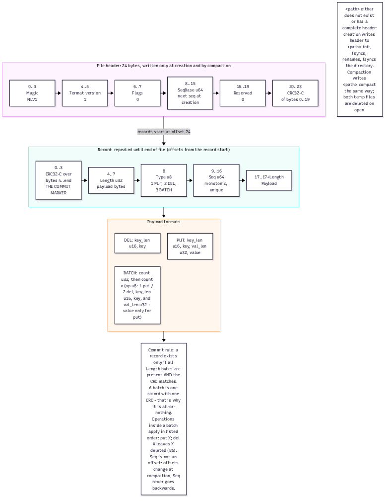
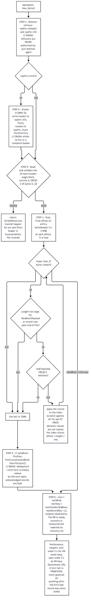
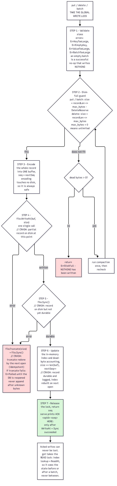

# NineLives

A crash-safe embedded key-value database in Go — standard library only — plus a
torture tool that SIGKILLs it at random moments and proves no acknowledged
write is ever lost. Built for the "Kill It and Prove It" hackathon.

**The three guarantees**

1. `put`, `del` and `batch` return success only after the record is written and
   fsynced. A printed `ACK`/`OK seq=` means the data is on disk, even if the
   process dies one millisecond later.
2. A batch is one record with one CRC: it is applied entirely or not at all,
   before or after a crash, and readers never see it half-applied.
3. Recovery keeps every acknowledged record. A torn tail (bytes from an
   interrupted write) is truncated, never guessed at, and truncation is
   idempotent — kill `open` during recovery and the next `open` just redoes it.

Deep design: [docs/SPEC.md](docs/SPEC.md) (frozen contract) ·
[ARCHITECTURE.md](ARCHITECTURE.md) (mechanisms, proof table) ·
[diagrams/](diagrams/README.md).

## Requirements

- **Go 1.27 or newer** (`go.mod` says `go 1.27`). Nothing else — no dependencies,
  no network, no services.
- **Linux or macOS.** Developed and tested on Linux. Windows is unsupported:
  it cannot rename over an open file and has no directory fsync, both of which
  the durability story depends on.

## Build

```sh
scripts/build.sh
```

```
built bin/ninelives and bin/torture
```

The script fails with a clear message if Go is missing or if an output binary
was not produced. Equivalent by hand:

```sh
go build -o bin/ninelives ./src/cmd/ninelives
go build -o bin/torture   ./torture
```

## Quick tour

Every block below is real output from a real run (start from an empty file):

```console
$ rm -f demo.db
$ ./bin/ninelives open demo.db
keys=0 recovery_ms=0
$ ./bin/ninelives put demo.db user:1 hello
OK seq=1
$ ./bin/ninelives put demo.db user:2 x:00ff
OK seq=2
$ ./bin/ninelives get demo.db user:1
hello
$ ./bin/ninelives get demo.db user:99
NOTFOUND
$ ./bin/ninelives del demo.db user:1
OK seq=3
$ ./bin/ninelives get demo.db user:1
NOTFOUND
$ ./bin/ninelives dump demo.db
user:2 x:00ff
$ ./bin/ninelives check demo.db
OK
$ ./bin/ninelives open demo.db
keys=1 recovery_ms=0
```

`keys=` is exact; `recovery_ms` is measured live on your machine, so the
number will differ (0–a few milliseconds on a small file — and likewise for
serve's `READY` line). Larger databases report proportionally more.

## Commands

```
ninelives open    <path> [--max-bytes N]   open or create, recover, print keys and recovery time
ninelives put     <path> <key> <value>     store a value
ninelives get     <path> <key>             print the value, or NOTFOUND
ninelives del     <path> <key>             delete a key (a missing key still writes a record)
ninelives batch   <path> <file>            apply a file of ops atomically
ninelives dump    <path>                   every key and value, sorted by raw key bytes
ninelives check   <path>                   read-only integrity check
ninelives compact <path>                   rewrite the log keeping only live keys
ninelives serve   <path>                   long-running: ops from stdin (see below)
```

Every command also accepts `--max-bytes N` (plain non-negative byte count,
before or after the path).

### Output and exit codes (exactly what scripts and the torture tool rely on)

| Command | Output | Exit |
|---|---|---|
| `open` | `keys=<n> recovery_ms=<ms>` | 0 |
| `put` / `del` / `batch` | `OK seq=<n>` | 0 |
| `compact` | `OK` | 0 |
| `get` hit | the value token | 0 |
| `get` miss | `NOTFOUND` | 0 |
| `dump` | `<key> <value>` per line, sorted by raw key bytes | 0 |
| `check` good | `OK` | 0 |
| `check` problem | `CORRUPT: <reason>` | 1 |
| any error | message on stderr | 1 |
| usage error (unknown command, wrong argument count, bad flag, malformed token or batch line) | message + usage on stderr | 2 |
| disk full | `… disk full (max_bytes reached)` | 3 |

```console
$ ./bin/ninelives frobnicate
ninelives: unknown command "frobnicate"
usage:
  ninelives open    <path> [--max-bytes N]
  ...
$ echo $?
2
```

### Batch files

One op per line: `put <key> <value>` or `del <key>`, tokens as below. Blank
lines and `#` comments are ignored. The whole file is applied as **one atomic
record**, or not at all if any line is malformed (exit 2, nothing written).

```console
$ printf 'put k1 v1\nput k2 v2\ndel k1\n' > ops.txt
$ cat ops.txt
put k1 v1
put k2 v2
del k1
$ rm -f batch.db
$ ./bin/ninelives batch batch.db ops.txt
OK seq=1
$ ./bin/ninelives dump batch.db
k2 v2
```

### Batch ordering (B5)

Operations inside a batch apply **in listed order**: the last operation on a
key wins. The session above is the proof — `put k1` then `del k1` in one batch
leaves `k1` deleted (`dump` shows only `k2`). The same holds after a crash,
because the batch never partially existed.

## Token encoding

A key or value argument is either:

- **raw text** — no whitespace, does not start with `x:` — used verbatim, or
- **`x:<lowercase hex>`** — arbitrary bytes; `x:` alone is the empty value.

`dump` prints raw text only when every byte is printable ASCII other than space
(and the text does not start with `x:`, which would be ambiguous); otherwise it
prints `x:<hex>`. Round-trip is exact either way:

```console
$ rm -f tokens.db
$ ./bin/ninelives put tokens.db k1 x:            # store the empty value
OK seq=1
$ ./bin/ninelives get tokens.db k1
x:
$ ./bin/ninelives put tokens.db k2 x:00ff        # two non-printable bytes
OK seq=2
$ ./bin/ninelives get tokens.db k2
x:00ff
$ ./bin/ninelives get tokens.db x:AB             # uppercase hex is rejected
ninelives get: token "x:AB" is not lowercase hex (SPEC section 10)
usage: …                               (the full usage block follows on stderr)
$ echo $?
2
```

## serve: the long-running protocol

`serve` opens the database (running recovery) and answers one request per line
on stdin; every response is one line on stdout, flushed immediately:

```console
$ rm -f serve.db
$ ./bin/ninelives serve serve.db
READY keys=0 recovery_ms=0
put user:3 hi
ACK 1 1
get user:3
VAL 2 hi
get nobody
NOTFOUND 3
```

Press Ctrl-D (stdin EOF): in-flight ops finish, the DB closes, exit 0 —
`./bin/ninelives open serve.db` then prints `keys=1`.

**Requests** — the `@<writer>:<opid>` prefix is optional (defaults: writer 0,
an auto-incrementing op-id), so a judge can type commands by hand:

```
[@w:id] put <key> <value>
[@w:id] del <key>
[@w:id] get <key>
[@w:id] batch <n>          then exactly n lines: "put <k> <v>" or "del <k>"
[@w:id] compact
[@w:id] stats
```

**Responses**

```
ACK <opid> <seq>              put/del/batch/compact succeeded and is durable
VAL <opid> <value-token>      get hit
NOTFOUND <opid>               get miss
STATS <opid> keys=.. file_bytes=.. dead_bytes=..
ERR <opid> <CODE> <message>   CODE is DISKFULL | BADREQ | TOOLARGE | FAILED
```

Rules you can build on:

- `ACK` is printed **only after** the engine call returned, i.e. after fsync.
- `ERR` guarantees nothing was written.
- Each writer id gets its own goroutine and queue: one writer's ops run in
  arrival order, different writers run concurrently (the engine lock
  serialises the disk writes).
- Batch blocks are read contiguously; one malformed line rejects the whole
  batch and the stream stays in sync.
- Lines of at least 4 MiB are accepted (a 1 MiB value is ~2 MiB of hex).
- On stdin EOF: in-flight ops finish, the DB closes, exit 0.

## On-disk format

One file is the database: a 24-byte header, then records until EOF. All
integers little-endian. This section is precise enough to write a parser —
and it is checked against a real hex dump below.



**File header (24 bytes)**, written only at creation and by compaction:

| Offset | Size | Field |
|---|---|---|
| 0 | 4 | Magic `NLV1` |
| 4 | 2 | Format version (1) |
| 6 | 2 | Flags (0) |
| 8 | 8 | SeqBase: next sequence number when the file was created |
| 16 | 4 | Reserved (0) |
| 20 | 4 | CRC32-C (Castagnoli) of bytes 0–19 |

**Record** (offsets from the record start):

| Offset | Size | Field |
|---|---|---|
| 0 | 4 | CRC32-C over bytes 4 to the end of the payload |
| 4 | 4 | Length: payload length |
| 8 | 1 | Type: `01` PUT, `02` DEL, `03` BATCH |
| 9 | 8 | Seq: monotonic, unique per record |
| 17 | Length | Payload |

**Payloads** (u16/u32/u64 little-endian):

```
PUT:   key_len u16 | key | val_len u32 | value
DEL:   key_len u16 | key
BATCH: count u32 | count × (op u8 [01 put / 02 del] | key_len u16 | key | [val_len u32 | value if put])
```

The CRC is the commit marker: a record exists only if all `Length` bytes are
present **and** the CRC matches. A batch is one record with one CRC — that is
why it is atomic.

### Verified hex dump

```console
$ rm -f demo.db
$ ./bin/ninelives put demo.db a hello
$ ./bin/ninelives put demo.db b x:0001ff
$ xxd demo.db
00000000: 4e4c 5631 0100 0000 0100 0000 0000 0000  NLV1............
00000010: 0000 0000 dfde 4f05 7128 3cc7 0c00 0000  ......O.q(<.....
00000020: 0101 0000 0000 0000 0001 0061 0500 0000  ...........a....
00000030: 6865 6c6c 6fc9 9a12 e30a 0000 0001 0200  hello...........
00000040: 0000 0000 0000 0100 6203 0000 0000 01ff  ........b.......
```

Byte-by-byte (every CRC below was recomputed with `hash/crc32.Castagnoli` and
matches):

| Offset | Bytes | Meaning |
|---|---|---|
| `0x00` | `4e 4c 56 31` | magic `NLV1` |
| `0x04` | `01 00` | format version 1 |
| `0x06` | `00 00` | flags 0 |
| `0x08` | `01 00 00 00 00 00 00 00` | SeqBase = 1 |
| `0x10` | `00 00 00 00` | reserved |
| `0x14` | `df de 4f 05` | header CRC32-C = `054fdedf` of bytes `0x00–0x13` ✅ |
| `0x18` | `71 28 3c c7` | record 1 CRC32-C = `c73c2871` of bytes `0x1c–0x34` ✅ |
| `0x1c` | `0c 00 00 00` | Length = 12 |
| `0x20` | `01` | type PUT |
| `0x21` | `01 00 00 00 00 00 00 00` | Seq = 1 |
| `0x29` | `01 00 61 05 00 00 00 68 65 6c 6c 6f` | key_len 1, `a`, val_len 5, `hello` |
| `0x35` | `c9 9a 12 e3` | record 2 CRC32-C = `e3129ac9` of bytes `0x39–0x4f` ✅ |
| `0x39` | `0a 00 00 00` | Length = 10 |
| `0x3d` | `01` | type PUT |
| `0x3e` | `02 00 00 00 00 00 00 00` | Seq = 2 |
| `0x46` | `01 00 62 03 00 00 00 00 01 ff` | key_len 1, `b`, val_len 3, bytes `00 01 ff` |

Total 80 bytes. On a fresh file the dump above is byte-for-byte reproducible.

## Recovery, in plain English

Opening a database does this, in order (details: SPEC §6,
`src/engine/recover.go`):

1. Delete leftover `<path>.compact` and `<path>.init` temp files — they are
   never authoritative.
2. If the file does not exist, create it: write the header to `<path>.init`,
   fsync, rename it into place, fsync the directory. So the file either does
   not exist or has a complete header.
3. Validate the header (magic, version, CRC). A bad header is `ErrNotNineLives`.
4. Scan records from offset 24. At each offset: is a full 17-byte header
   present? Is `Length` sane and inside the file? Does the CRC match? If any
   answer is no, the **tail is torn** — stop. If all are yes, apply the record
   to the in-memory index (a whole batch at once) and advance.
5. If the file is longer than the last good record, `Truncate` it there and
   fsync. This is idempotent: killed during it, the next open simply repeats it.
6. Set `size`, `nextSeq = max(SeqBase, maxRecordSeq + 1)`, compute dead bytes,
   measure elapsed time — that is the `recovery_ms` you see.

Nothing acknowledged is ever lost: an acked record was fsynced before its
`OK`/`ACK` was printed, so it always sits before any torn tail.



## A write, step by step (durability)



Under the global write lock: validate sizes → disk-full guard → encode one
buffer with `seq` → `WriteAt` → **`Sync`** → update index and dead bytes →
release, return `seq`. Only then does serve print `ACK`. If a write or fsync
errors, the partial record is truncated away; if even that fails the database
poisons itself with `ErrFailed` (exit 1) until reopened — it never appends
after unknown bytes, because recovery would stop there and drop every acked
record behind it.

## Disk-full behaviour (`--max-bytes`)

- put/batch must fit in `max_bytes − DeleteReserve` (64 KiB kept free so
  deletes can always be written); deletes may use the reserve.
- If a write does not fit and the file has dead bytes, compaction runs once
  and the check repeats; still no room → `ErrDiskFull`, **nothing written**.
- CLI exits **3**; serve answers `ERR <id> DISKFULL …`. The database is not
  poisoned: the next smaller write succeeds.

```console
$ ./bin/ninelives put demo.db bigkey "$(head -c 500 /dev/zero | tr '\0' v)" --max-bytes 100
ninelives put: ninelives: disk full (max_bytes reached)
$ echo $?
3
```

## Compaction

Rewrites only live keys into `<path>.compact` (with their original seqs),
fsyncs it, atomically renames it over the original, fsyncs the directory, and
swaps handles — under the write lock, so readers never see a half-swapped
file. It runs **automatically** when the file is ≥ 4 MiB and more than half of
it is dead, **from the disk-full guard**, or explicitly:

```console
$ ./bin/ninelives compact demo.db
OK
```

(serve: send the `compact` op; it answers `ACK <opid> 0` because no record is
written.) Measured on this machine: 2 000 puts + 1 500 deletes → 151 703
bytes; `compact` → 29 024 bytes; `check` still `OK`.

If killed mid-compaction the old file stays authoritative (before the rename)
or the new one is already complete (after it, thanks to the fsync) — see
C3–C5 in [docs/SCENARIOS.md](docs/SCENARIOS.md).

## Crash points (for demos and testing)

The engine can kill itself with a real SIGKILL at 13 named points
(`before_write`, `mid_write`, `after_fsync`, `recovery_mid_scan`,
`compact_after_rename`, … — full list in SPEC §8):

```sh
NINELIVES_CRASH_AT=after_fsync NINELIVES_CRASH_AFTER=1 ./bin/ninelives put demo.db k v
# process is SIGKILLed on purpose; reopening shows the state at that point
```

These supplement, never replace, random kills.

## Running the torture tool

```console
$ ./bin/torture --iterations 3 --seed 12345
torture: seed=12345 mode=default iterations=3, oracle log runs/12345/oracle.log
iter 1/3 ok  delay=86ms sent=61 acked=59 err=0 inflight=2 keys=50 recovery_ms=0
iter 2/3 ok  delay=249ms sent=167 acked=165 err=0 inflight=2 keys=51 recovery_ms=0
iter 3/3 ok  delay=92ms sent=59 acked=57 err=0 inflight=2 keys=48 recovery_ms=0
PASS 3/3 iterations (seed 12345, mode default)
```

| Flag | Meaning |
|---|---|
| `--seed <n>` | **mandatory**; every random decision derives from it |
| `--iterations <n>` | kill/restart loops (default 500) |
| `--mode <m>` | `default`, `large-values`, `large-batch`, `disk-full`, `recovery-crash`, `compaction`, `crashpoints` (all 7 work) |
| `--bin <path>` | the `ninelives` binary (default `./bin/ninelives`) |
| `--dir <path>` | where `runs/<seed>/` databases and `oracle.log` go (default `runs/`) |
| `--max-bytes <n>` | forwarded to serve |

Each iteration: spawn `serve`, drive it with **two synchronous writers**,
SIGKILL at a genuinely random millisecond delay, then `open`, `check`, `dump`
and **verify the dump against the oracle log** (the SPEC §13 rules: every
acked write present, batches all-or-nothing, no unknown values) before the
one-line summary. `PASS n/n` means every acked write survived every kill.

Reproducibility: the same `--seed` reproduces the operation stream and the
kill delays (the block above came out byte-identical on a second run with
seed 12345), but OS scheduling decides how far each writer gets before the
SIGKILL — so `sent`/`acked`/`keys` vary from run to run. That is expected
and documented (SPEC §13 rule 10), not a bug. `runs/<seed>/oracle.log`
records what was sent and what was acked — independently of the database.
Full mode list and oracle rules: [docs/SCENARIOS.md](docs/SCENARIOS.md)
and SPEC §13.

## Repository layout

```
src/engine/       the storage engine (append-only log + in-memory index)
src/cmd/ninelives/  the CLI and serve (this README's subject)
torture/          the kill-it-and-prove-it harness
tests/            engine and CLI integration tests (go test ./...)
scripts/build.sh  the one build command
diagrams/         Mermaid sources + exported PNGs
docs/SPEC.md      the frozen design contract
ARCHITECTURE.md   mechanisms and the 32-scenario proof table
```

## Platform notes

Tested on Linux. macOS should behave the same (`rename` over an open file and
directory fsync both work there) but has not been exercised in this session —
honest status, not a claim. Windows is unsupported by design (no rename-over-
open-file, no directory fsync). The runtime never touches the network.
