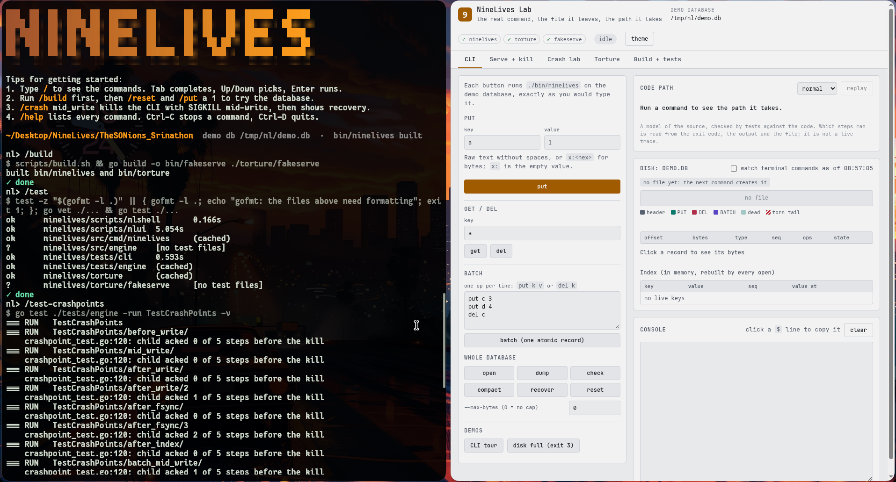
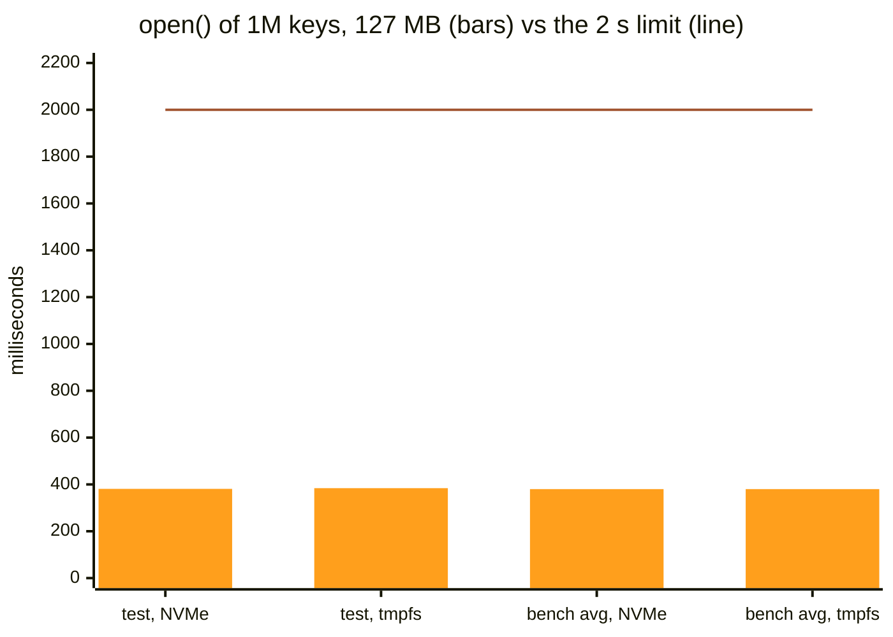
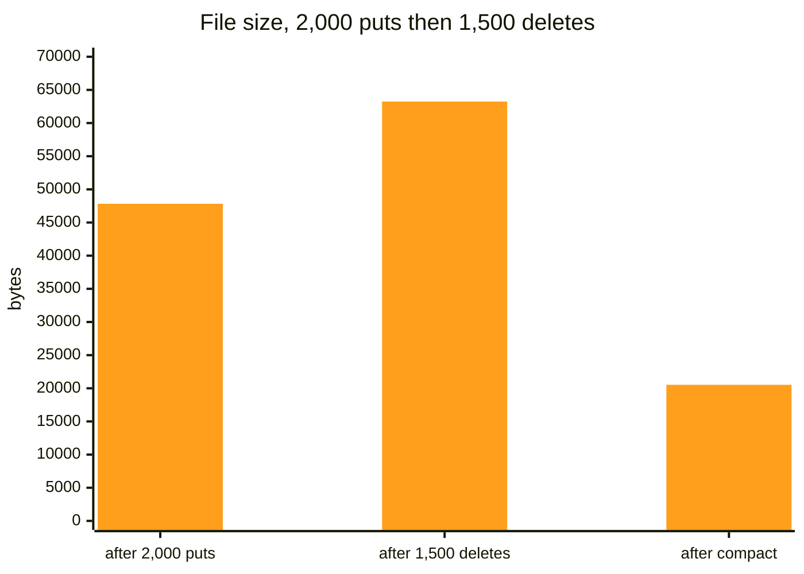
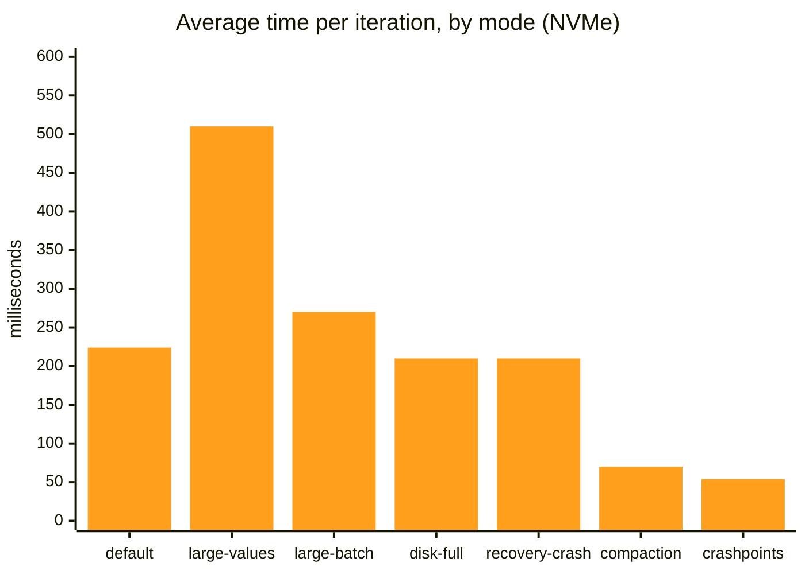

# NineLives

A crash-safe embedded key-value database in Go — standard library only — plus a
torture tool that SIGKILLs it at random moments and proves no acknowledged
write is ever lost. Built for the "Kill It and Prove It" hackathon.



*Left: `nlshell`, the test menu (`/build`, `/test`, `/test-crashpoints`, …).
Right: NineLives Lab (`scripts/nlui`), the same commands in a local window
with the database file drawn record by record. Both are optional demo tools;
everything they do is plain `./bin/ninelives` and `./bin/torture` commands,
listed in [Test it yourself](#test-it-yourself-what-a-judge-runs).*

**Contents:** [Guarantees](#the-three-guarantees) ·
[Clone and test](#test-it-yourself-what-a-judge-runs) ·
[Benchmarks](#benchmarks) · [Commands](#commands) · [serve](#serve-the-long-running-protocol) ·
[File format](#on-disk-format) · [Recovery](#recovery-in-plain-english) ·
[Torture tool](#running-the-torture-tool) · [Layout](#repository-layout)

## The three guarantees

1. `put`, `del` and `batch` return success only after the record is written and
   fsynced. A printed `ACK`/`OK seq=` means the data is on disk, even if the
   process dies one millisecond later.
2. A batch is one record with one CRC: it is applied entirely or not at all,
   before or after a crash, and readers never see it half-applied.
3. Recovery keeps every acknowledged record. A torn tail (bytes from an
   interrupted write) is truncated, never guessed at, and truncation is
   idempotent — kill `open` during recovery and the next `open` just redoes it.

Deep design: [docs/SPEC.md](docs/SPEC.md) (frozen contract) ·
[ARCHITECTURE.md](ARCHITECTURE.md) (mechanisms, proof table) ·
[diagrams/](diagrams/README.md).

## Requirements

- **Go 1.27 or newer** (`go.mod` says `go 1.27`). Nothing else — no dependencies,
  no network, no services.
- **Linux or macOS.** Developed and tested on Linux. Windows is unsupported:
  it cannot rename over an open file and has no directory fsync, both of which
  the durability story depends on.

## Build

```sh
scripts/build.sh
```

```
built bin/ninelives and bin/torture
```

The script fails with a clear message if Go is missing or if an output binary
was not produced. Equivalent by hand:

```sh
go build -o bin/ninelives ./src/cmd/ninelives
go build -o bin/torture   ./torture
```

## Test it yourself: what a judge runs

Every step below is copy-paste from the repository root, in this order. The
outputs are real, captured from a fresh clone on 2026-11-07 (Linux, Go
1.27.3). `recovery_ms`, torture counts and timings are measured live, so
yours will differ; everything else should match exactly.

### Step 0. Clone, build, run the test suite

```sh
git clone https://github.com/ANI-CPU-tech/TheSONions_Srinathon.git
cd TheSONions_Srinathon
go version          # must say go1.27 or newer
scripts/build.sh    # builds bin/ninelives and bin/torture; no network needed
go vet ./...        # prints nothing
go test ./...       # about 20 s; includes the 1M-key recovery test
```

```console
built bin/ninelives and bin/torture
ok  	ninelives/scripts/nlshell	0.242s
ok  	ninelives/scripts/nlui	5.102s
ok  	ninelives/src/cmd/ninelives	0.004s
?   	ninelives/src/engine	[no test files]
ok  	ninelives/tests/cli	0.727s
ok  	ninelives/tests/engine	2.958s
ok  	ninelives/torture	7.241s
?   	ninelives/torture/fakeserve	[no test files]
```

(`src/engine` has no test files of its own: its tests live in `tests/engine`,
so they use only the public API.)

### Step 1. Every CLI command, with the exit codes

```console
$ ./bin/ninelives open judge.db
keys=0 recovery_ms=0
$ ./bin/ninelives put judge.db user:1 alice
OK seq=1
$ ./bin/ninelives put judge.db user:2 x:00ff
OK seq=2
$ ./bin/ninelives get judge.db user:1
alice
$ ./bin/ninelives get judge.db user:99
NOTFOUND
$ ./bin/ninelives del judge.db user:1
OK seq=3
$ printf 'put k1 v1\nput k2 v2\ndel k1\n' > ops.txt
$ ./bin/ninelives batch judge.db ops.txt
OK seq=4
$ ./bin/ninelives dump judge.db
k2 v2
user:2 x:00ff
$ ./bin/ninelives check judge.db
OK
$ ./bin/ninelives compact judge.db
OK
$ ./bin/ninelives open judge.db
keys=2 recovery_ms=0
$ ./bin/ninelives frobnicate; echo "exit=$?"         # usage error
ninelives: unknown command "frobnicate"
usage:
  ninelives open    <path> [--max-bytes N]
  ...                                  (the rest of the usage block)
exit=2
$ ./bin/ninelives put judge.db big "$(head -c 500 /dev/zero | tr '\0' v)" --max-bytes 100; echo "exit=$?"
ninelives put: ninelives: disk full (max_bytes reached)
exit=3
```

What to look for: the batch is one record (`seq=4`) and applies in order
(`put k1` then `del k1` leaves no `k1`); `dump` is sorted by raw key bytes;
exit codes are 0, 2 (usage) and 3 (disk full), as in the
[table below](#output-and-exit-codes-exactly-what-scripts-and-the-torture-tool-rely-on).

### Step 2. serve, then a real SIGKILL

By hand, in two terminals:

```sh
# terminal 1
./bin/ninelives serve serve.db
# type: put a 1   then: batch 2   put b 2   del a   then: get b
# terminal 2
pkill -9 -f 'ninelives serve'
# terminal 1 again
./bin/ninelives check serve.db && ./bin/ninelives dump serve.db
```

The same thing as one script (real output):

```console
$ (printf "put a 1\nbatch 2\nput b 2\ndel a\nget b\n"; sleep 5) | ./bin/ninelives serve serve.db &
READY keys=0 recovery_ms=0
ACK 1 1
ACK 2 2
VAL 3 2
$ kill -9 $!
$ ./bin/ninelives check serve.db
OK
$ ./bin/ninelives dump serve.db
b 2
```

Every `ACK` was printed after its fsync, so both acked writes survive the
kill: `a` was put and then deleted by the batch, `b` is there.

### Step 3. Kill it at an exact line of code (crash points)

The engine can SIGKILL itself at 13 named points. `mid_write` dies halfway
through writing a record, leaving a torn tail on disk:

```console
$ ./bin/ninelives put crash.db a 1
OK seq=1
$ NINELIVES_CRASH_AT=mid_write ./bin/ninelives put crash.db b 2; echo "exit=$?"
Killed                                 (bash's message; zsh says "killed")
exit=137
$ ./bin/ninelives check crash.db
CORRUPT: ninelives: corrupt file: torn tail at offset 49 (file is 61 bytes)
$ ./bin/ninelives open crash.db
keys=1 recovery_ms=0
$ ./bin/ninelives check crash.db
OK
$ ./bin/ninelives dump crash.db
a 1
```

`check` is read-only, so it reports the torn tail; `open` runs recovery and
cuts it. The acked `a 1` survives, the never-acked `b 2` is gone. All 13
points (`before_write`, `mid_write`, `after_write`, `after_fsync`,
`after_index`, `batch_mid_write`, `compact_mid_temp`,
`compact_after_temp_fsync`, `compact_after_rename`, `compact_after_dir_fsync`,
`recovery_mid_scan`, `recovery_before_truncate`, `recovery_after_truncate`)
are checked by one test:

```sh
go test ./tests/engine -run TestCrashPoints -v
```

### Step 4. The torture tool, every mode

The judge's command is `./bin/torture --iterations 500 --seed <any number>`.
Each mode below stresses something different; every run must end with
`PASS n/n` and exit 0. Use a seed nobody has used before.

| Mode | Command | What changes |
|---|---|---|
| `default` | `./bin/torture --seed 80421 --iterations 500` | 2 writers send puts, dels and 2–10-op batches; SIGKILL at a random 1–400 ms after `READY` |
| `large-values` | `./bin/torture --seed 5150 --iterations 100 --mode large-values` | values up to 1 MiB; a quarter are exactly 1 MiB |
| `large-batch` | `./bin/torture --seed 2718 --iterations 100 --mode large-batch` | batches up to 10,000 ops; half are exactly 10,000 |
| `disk-full` | `./bin/torture --seed 1618 --iterations 100 --mode disk-full` | serve gets `--max-bytes 131072`, so writes keep hitting the cap |
| `recovery-crash` | `./bin/torture --seed 4711 --iterations 100 --mode recovery-crash` | after the kill, 1–3 `open()`s are SIGKILLed during recovery |
| `compaction` | `./bin/torture --seed 777 --iterations 100 --mode compaction` | 5% of requests are `compact`; SIGKILL 0–3 ms after the 1st–5th one |
| `crashpoints` | `./bin/torture --seed 9001 --iterations 130 --mode crashpoints` | each iteration arms one of the 13 crash points, in turn |

A run looks like this (seed 1073356830, the first 3 of 20 iterations):

```console
torture: seed=1073356830 mode=default iterations=20, oracle log runs/1073356830/oracle.log
iter 1/20 ok  delay=225ms sent=17485 acked=17483 err=0 inflight=2 keys=46 recovery_ms=3
iter 2/20 ok  delay=31ms sent=2293 acked=2292 err=0 inflight=1 keys=46 recovery_ms=7
iter 3/20 ok  delay=4ms sent=237 acked=235 err=0 inflight=2 keys=51 recovery_ms=4
…
PASS 20/20 iterations (seed 1073356830, mode default)
```

That run used tmpfs (RAM), where fsync costs nothing, hence the high
`sent` counts. On a real disk each fsync waits for the device, so fewer ops
fit before the kill. Run it on a real disk for the honest test.

### Step 5. Prove the checker is not rigged

`torture/fakeserve` is a deliberately broken server. Each `--bug` breaks one
promise; the oracle must catch every one of them (exit 1), and must pass the
honest version:

```console
$ go build -o bin/fakeserve ./torture/fakeserve
$ ./bin/torture --seed 11 --iterations 5 --bin ./bin/fakeserve --bug drop-ack --dir runs/selftest | tail -1
FAILED after 0 of 5 iterations passed (seed 11, mode default)
$ ./bin/torture --seed 11 --iterations 5 --bin ./bin/fakeserve --bug partial-batch --dir runs/selftest | tail -1
FAILED after 0 of 5 iterations passed (seed 11, mode default)
$ ./bin/torture --seed 11 --iterations 5 --bin ./bin/fakeserve --bug garbage --dir runs/selftest | tail -1
FAILED after 0 of 5 iterations passed (seed 11, mode default)
$ ./bin/torture --seed 11 --iterations 5 --bin ./bin/fakeserve --bug stale --dir runs/selftest | tail -1
FAILED after 0 of 5 iterations passed (seed 11, mode default)
$ ./bin/torture --seed 12 --iterations 3 --bin ./bin/fakeserve --bug none --dir runs/selftest | tail -1
PASS 3/3 iterations (seed 12, mode default)
```

`drop-ack` loses an acked write, `partial-batch` applies half a batch,
`garbage` returns a value nobody wrote, `stale` returns an old value.

### Step 6. One million keys, recovered in under 2 seconds

```console
$ go test ./tests/engine -run TestRecoveryMillionKeysUnder2s -v
=== RUN   TestRecoveryMillionKeysUnder2s
    recovery_bench_test.go:59: 1M keys, 127 MB file: open 380.984605ms (Stats.RecoveryTime 380.984253ms)
--- PASS: TestRecoveryMillionKeysUnder2s (0.55s)
```

The test fails if `open()` takes more than 2 s. Details and graphs:
[Benchmarks](#benchmarks).

### Step 7 (optional). The same tests from a menu or a window

```sh
go build -o bin/nlshell ./scripts/nlshell && ./bin/nlshell    # terminal menu
go build -o bin/nlui    ./scripts/nlui    && ./bin/nlui        # local window, 127.0.0.1 only
```

These are the two tools in the screenshot at the top. Each one prints the
exact command it runs. The full list of menu commands and what each should
print is in [docs/TESTING.md](docs/TESTING.md).

### Checklist

| What the brief asks | Command | Pass looks like |
|---|---|---|
| One-command build, no dependencies | `scripts/build.sh` | `built bin/ninelives and bin/torture` |
| All CLI commands and exit codes | Step 1 | outputs above; exit 0, 2, 3 |
| Acked writes survive SIGKILL | Step 2, Step 4 | `check` says `OK`; `PASS n/n` |
| Torn writes are cut, never guessed | Step 3 | `CORRUPT` before `open`, `OK` after |
| Batches are all-or-nothing | `--mode large-batch`, `crashpoints` (`batch_mid_write`) | `PASS n/n` |
| Disk full is clean | Step 1 (exit 3), `--mode disk-full` | `PASS n/n` |
| Recovery survives being killed | `--mode recovery-crash` | `PASS n/n` |
| The checker catches real bugs | Step 5 | 4 × `FAILED`, then `PASS 3/3` |
| 1M keys open in under 2 s | Step 6 | `--- PASS`, about 0.4 s |

## Quick tour

Every block below is real output from a real run (start from an empty file):

```console
$ rm -f demo.db
$ ./bin/ninelives open demo.db
keys=0 recovery_ms=0
$ ./bin/ninelives put demo.db user:1 hello
OK seq=1
$ ./bin/ninelives put demo.db user:2 x:00ff
OK seq=2
$ ./bin/ninelives get demo.db user:1
hello
$ ./bin/ninelives get demo.db user:99
NOTFOUND
$ ./bin/ninelives del demo.db user:1
OK seq=3
$ ./bin/ninelives get demo.db user:1
NOTFOUND
$ ./bin/ninelives dump demo.db
user:2 x:00ff
$ ./bin/ninelives check demo.db
OK
$ ./bin/ninelives open demo.db
keys=1 recovery_ms=0
```

`keys=` is exact; `recovery_ms` is measured live on your machine, so the
number will differ (0–a few milliseconds on a small file — and likewise for
serve's `READY` line). Larger databases report proportionally more.

## Commands

```
ninelives open    <path> [--max-bytes N]   open or create, recover, print keys and recovery time
ninelives put     <path> <key> <value>     store a value
ninelives get     <path> <key>             print the value, or NOTFOUND
ninelives del     <path> <key>             delete a key (a missing key still writes a record)
ninelives batch   <path> <file>            apply a file of ops atomically
ninelives dump    <path>                   every key and value, sorted by raw key bytes
ninelives check   <path>                   read-only integrity check
ninelives compact <path>                   rewrite the log keeping only live keys
ninelives serve   <path>                   long-running: ops from stdin (see below)
```

Every command also accepts `--max-bytes N` (plain non-negative byte count,
before or after the path).

### Output and exit codes (exactly what scripts and the torture tool rely on)

| Command | Output | Exit |
|---|---|---|
| `open` | `keys=<n> recovery_ms=<ms>` | 0 |
| `put` / `del` / `batch` | `OK seq=<n>` | 0 |
| `compact` | `OK` | 0 |
| `get` hit | the value token | 0 |
| `get` miss | `NOTFOUND` | 0 |
| `dump` | `<key> <value>` per line, sorted by raw key bytes | 0 |
| `check` good | `OK` | 0 |
| `check` problem | `CORRUPT: <reason>` | 1 |
| any error | message on stderr | 1 |
| usage error (unknown command, wrong argument count, bad flag, malformed token or batch line) | message + usage on stderr | 2 |
| disk full | `… disk full (max_bytes reached)` | 3 |

```console
$ ./bin/ninelives frobnicate
ninelives: unknown command "frobnicate"
usage:
  ninelives open    <path> [--max-bytes N]
  ...
$ echo $?
2
```

### Batch files

One op per line: `put <key> <value>` or `del <key>`, tokens as below. Blank
lines and `#` comments are ignored. The whole file is applied as **one atomic
record**, or not at all if any line is malformed (exit 2, nothing written).

```console
$ printf 'put k1 v1\nput k2 v2\ndel k1\n' > ops.txt
$ cat ops.txt
put k1 v1
put k2 v2
del k1
$ rm -f batch.db
$ ./bin/ninelives batch batch.db ops.txt
OK seq=1
$ ./bin/ninelives dump batch.db
k2 v2
```

### Batch ordering (B5)

Operations inside a batch apply **in listed order**: the last operation on a
key wins. The session above is the proof — `put k1` then `del k1` in one batch
leaves `k1` deleted (`dump` shows only `k2`). The same holds after a crash,
because the batch never partially existed.

## Token encoding

A key or value argument is either:

- **raw text** — no whitespace, does not start with `x:` — used verbatim, or
- **`x:<lowercase hex>`** — arbitrary bytes; `x:` alone is the empty value.

`dump` prints raw text only when every byte is printable ASCII other than space
(and the text does not start with `x:`, which would be ambiguous); otherwise it
prints `x:<hex>`. Round-trip is exact either way:

```console
$ rm -f tokens.db
$ ./bin/ninelives put tokens.db k1 x:            # store the empty value
OK seq=1
$ ./bin/ninelives get tokens.db k1
x:
$ ./bin/ninelives put tokens.db k2 x:00ff        # two non-printable bytes
OK seq=2
$ ./bin/ninelives get tokens.db k2
x:00ff
$ ./bin/ninelives get tokens.db x:AB             # uppercase hex is rejected
ninelives get: token "x:AB" is not lowercase hex (SPEC section 10)
usage: …                               (the full usage block follows on stderr)
$ echo $?
2
```

## serve: the long-running protocol

`serve` opens the database (running recovery) and answers one request per line
on stdin; every response is one line on stdout, flushed immediately:

```console
$ rm -f serve.db
$ ./bin/ninelives serve serve.db
READY keys=0 recovery_ms=0
put user:3 hi
ACK 1 1
get user:3
VAL 2 hi
get nobody
NOTFOUND 3
```

Press Ctrl-D (stdin EOF): in-flight ops finish, the DB closes, exit 0 —
`./bin/ninelives open serve.db` then prints `keys=1`.

**Requests** — the `@<writer>:<opid>` prefix is optional (defaults: writer 0,
an auto-incrementing op-id), so a judge can type commands by hand:

```
[@w:id] put <key> <value>
[@w:id] del <key>
[@w:id] get <key>
[@w:id] batch <n>          then exactly n lines: "put <k> <v>" or "del <k>"
[@w:id] compact
[@w:id] stats
```

**Responses**

```
ACK <opid> <seq>              put/del/batch/compact succeeded and is durable
VAL <opid> <value-token>      get hit
NOTFOUND <opid>               get miss
STATS <opid> keys=.. file_bytes=.. dead_bytes=..
ERR <opid> <CODE> <message>   CODE is DISKFULL | BADREQ | TOOLARGE | FAILED
```

Rules you can build on:

- `ACK` is printed **only after** the engine call returned, i.e. after fsync.
- `ERR` guarantees nothing was written.
- Each writer id gets its own goroutine and queue: one writer's ops run in
  arrival order, different writers run concurrently (the engine lock
  serialises the disk writes).
- Batch blocks are read contiguously; one malformed line rejects the whole
  batch and the stream stays in sync.
- Lines of at least 4 MiB are accepted (a 1 MiB value is ~2 MiB of hex).
- On stdin EOF: in-flight ops finish, the DB closes, exit 0.

## On-disk format

One file is the database: a 24-byte header, then records until EOF. All
integers little-endian. This section is precise enough to write a parser —
and it is checked against a real hex dump below.


**File header (24 bytes)**, written only at creation and by compaction:

| Offset | Size | Field |
|---|---|---|
| 0 | 4 | Magic `NLV1` |
| 4 | 2 | Format version (1) |
| 6 | 2 | Flags (0) |
| 8 | 8 | SeqBase: next sequence number when the file was created |
| 16 | 4 | Reserved (0) |
| 20 | 4 | CRC32-C (Castagnoli) of bytes 0–19 |

**Record** (offsets from the record start):

| Offset | Size | Field |
|---|---|---|
| 0 | 4 | CRC32-C over bytes 4 to the end of the payload |
| 4 | 4 | Length: payload length |
| 8 | 1 | Type: `01` PUT, `02` DEL, `03` BATCH |
| 9 | 8 | Seq: monotonic, unique per record |
| 17 | Length | Payload |

**Payloads** (u16/u32/u64 little-endian):

```
PUT:   key_len u16 | key | val_len u32 | value
DEL:   key_len u16 | key
BATCH: count u32 | count × (op u8 [01 put / 02 del] | key_len u16 | key | [val_len u32 | value if put])
```

The CRC is the commit marker: a record exists only if all `Length` bytes are
present **and** the CRC matches. A batch is one record with one CRC — that is
why it is atomic.

### Verified hex dump

```console
$ rm -f demo.db
$ ./bin/ninelives put demo.db a hello
$ ./bin/ninelives put demo.db b x:0001ff
$ xxd demo.db
00000000: 4e4c 5631 0100 0000 0100 0000 0000 0000  NLV1............
00000010: 0000 0000 dfde 4f05 7128 3cc7 0c00 0000  ......O.q(<.....
00000020: 0101 0000 0000 0000 0001 0061 0500 0000  ...........a....
00000030: 6865 6c6c 6fc9 9a12 e30a 0000 0001 0200  hello...........
00000040: 0000 0000 0000 0100 6203 0000 0000 01ff  ........b.......
```

Byte-by-byte (every CRC below was recomputed with `hash/crc32.Castagnoli` and
matches):

| Offset | Bytes | Meaning |
|---|---|---|
| `0x00` | `4e 4c 56 31` | magic `NLV1` |
| `0x04` | `01 00` | format version 1 |
| `0x06` | `00 00` | flags 0 |
| `0x08` | `01 00 00 00 00 00 00 00` | SeqBase = 1 |
| `0x10` | `00 00 00 00` | reserved |
| `0x14` | `df de 4f 05` | header CRC32-C = `054fdedf` of bytes `0x00–0x13` ✅ |
| `0x18` | `71 28 3c c7` | record 1 CRC32-C = `c73c2871` of bytes `0x1c–0x34` ✅ |
| `0x1c` | `0c 00 00 00` | Length = 12 |
| `0x20` | `01` | type PUT |
| `0x21` | `01 00 00 00 00 00 00 00` | Seq = 1 |
| `0x29` | `01 00 61 05 00 00 00 68 65 6c 6c 6f` | key_len 1, `a`, val_len 5, `hello` |
| `0x35` | `c9 9a 12 e3` | record 2 CRC32-C = `e3129ac9` of bytes `0x39–0x4f` ✅ |
| `0x39` | `0a 00 00 00` | Length = 10 |
| `0x3d` | `01` | type PUT |
| `0x3e` | `02 00 00 00 00 00 00 00` | Seq = 2 |
| `0x46` | `01 00 62 03 00 00 00 00 01 ff` | key_len 1, `b`, val_len 3, bytes `00 01 ff` |

Total 80 bytes. On a fresh file the dump above is byte-for-byte reproducible.

## Recovery, in plain English

Opening a database does this, in order (details: SPEC §6,
`src/engine/recover.go`):

1. Delete leftover `<path>.compact` and `<path>.init` temp files — they are
   never authoritative.
2. If the file does not exist, create it: write the header to `<path>.init`,
   fsync, rename it into place, fsync the directory. So the file either does
   not exist or has a complete header.
3. Validate the header (magic, version, CRC). A bad header is `ErrNotNineLives`.
4. Scan records from offset 24. At each offset: is a full 17-byte header
   present? Is `Length` sane and inside the file? Does the CRC match? If any
   answer is no, the **tail is torn** — stop. If all are yes, apply the record
   to the in-memory index (a whole batch at once) and advance.
5. If the file is longer than the last good record, `Truncate` it there and
   fsync. This is idempotent: killed during it, the next open simply repeats it.
6. Set `size`, `nextSeq = max(SeqBase, maxRecordSeq + 1)`, compute dead bytes,
   measure elapsed time — that is the `recovery_ms` you see.

Nothing acknowledged is ever lost: an acked record was fsynced before its
`OK`/`ACK` was printed, so it always sits before any torn tail.


## A write, step by step (durability)


Under the global write lock: validate sizes → disk-full guard → encode one
buffer with `seq` → `WriteAt` → **`Sync`** → update index and dead bytes →
release, return `seq`. Only then does serve print `ACK`. If a write or fsync
errors, the partial record is truncated away; if even that fails the database
poisons itself with `ErrFailed` (exit 1) until reopened — it never appends
after unknown bytes, because recovery would stop there and drop every acked
record behind it.

## Disk-full behaviour (`--max-bytes`)

- put/batch must fit in `max_bytes − DeleteReserve` (64 KiB kept free so
  deletes can always be written); deletes may use the reserve.
- If a write does not fit and the file has dead bytes, compaction runs once
  and the check repeats; still no room → `ErrDiskFull`, **nothing written**.
- CLI exits **3**; serve answers `ERR <id> DISKFULL …`. The database is not
  poisoned: the next smaller write succeeds.

```console
$ ./bin/ninelives put demo.db bigkey "$(head -c 500 /dev/zero | tr '\0' v)" --max-bytes 100
ninelives put: ninelives: disk full (max_bytes reached)
$ echo $?
3
```

## Compaction

Rewrites only live keys into `<path>.compact` (with their original seqs),
fsyncs it, atomically renames it over the original, fsyncs the directory, and
swaps handles — under the write lock, so readers never see a half-swapped
file. It runs **automatically** when the file is ≥ 4 MiB and more than half of
it is dead, **from the disk-full guard**, or explicitly:

```console
$ ./bin/ninelives compact demo.db
OK
```

(serve: send the `compact` op; it answers `ACK <opid> 0` because no record is
written.) Measured on this machine: 2 000 puts + 1 500 deletes → 151 703
bytes; `compact` → 29 024 bytes; `check` still `OK`.

If killed mid-compaction the old file stays authoritative (before the rename)
or the new one is already complete (after it, thanks to the fsync) — see
C3–C5 in [docs/SCENARIOS.md](docs/SCENARIOS.md).

## Crash points (for demos and testing)

The engine can kill itself with a real SIGKILL at 13 named points
(`before_write`, `mid_write`, `after_fsync`, `recovery_mid_scan`,
`compact_after_rename`, … — full list in SPEC §8):

```sh
NINELIVES_CRASH_AT=after_fsync NINELIVES_CRASH_AFTER=1 ./bin/ninelives put demo.db k v
# process is SIGKILLed on purpose; reopening shows the state at that point
```

These supplement, never replace, random kills.

## Running the torture tool

```console
$ ./bin/torture --iterations 3 --seed 12345
torture: seed=12345 mode=default iterations=3, oracle log runs/12345/oracle.log
iter 1/3 ok  delay=86ms sent=61 acked=59 err=0 inflight=2 keys=50 recovery_ms=0
iter 2/3 ok  delay=249ms sent=167 acked=165 err=0 inflight=2 keys=51 recovery_ms=0
iter 3/3 ok  delay=92ms sent=59 acked=57 err=0 inflight=2 keys=48 recovery_ms=0
PASS 3/3 iterations (seed 12345, mode default)
```

| Flag | Meaning |
|---|---|
| `--seed <n>` | **mandatory**; every random decision derives from it |
| `--iterations <n>` | kill/restart loops (default 500) |
| `--mode <m>` | `default`, `large-values`, `large-batch`, `disk-full`, `recovery-crash`, `compaction`, `crashpoints` (all 7 work; see [Step 4](#step-4-the-torture-tool-every-mode)) |
| `--bin <path>` | the `ninelives` binary (default `./bin/ninelives`) |
| `--dir <path>` | where `runs/<seed>/` databases and `oracle.log` go (default `runs/`) |
| `--max-bytes <n>` | forwarded to serve |

Each iteration: spawn `serve`, drive it with **two synchronous writers**,
SIGKILL at a genuinely random millisecond delay, then `open`, `check`, `dump`
and **verify the dump against the oracle log** (the SPEC §13 rules: every
acked write present, batches all-or-nothing, no unknown values) before the
one-line summary. `PASS n/n` means every acked write survived every kill.

Reproducibility: the same `--seed` reproduces the operation stream and the
kill delays (the block above came out byte-identical on a second run with
seed 12345), but OS scheduling decides how far each writer gets before the
SIGKILL — so `sent`/`acked`/`keys` vary from run to run. That is expected
and documented (SPEC §13 rule 10), not a bug. `runs/<seed>/oracle.log`
records what was sent and what was acked — independently of the database.
Full mode list and oracle rules: [docs/SCENARIOS.md](docs/SCENARIOS.md)
and SPEC §13.

## Benchmarks

Three things are measured: how fast `open()` recovers a big database, how
much compaction gives back, and how long a torture iteration takes. Every
number below comes from a command in this repo that you can rerun; the
machine was a laptop with an Intel i5-12450HX, NVMe SSD (btrfs), Linux.

### 1. Recovery: 1M keys in under 2 seconds (scenario F3)

The brief's limit: a database holding 1,000,000 keys must open in under 2 s.
The test writes the exact file that 1M separate `put` calls would leave
(one PUT record each, 11-byte keys, 100-byte values, 127 MB), then times
`engine.Open`, which scans every record, checks every CRC and rebuilds the
in-memory index.



| Run (2026-11-07) | `open()` time | Memory | Allocations |
|---|---|---|---|
| `TestRecoveryMillionKeysUnder2s`, NVMe | 381 ms | | |
| `TestRecoveryMillionKeysUnder2s`, tmpfs | 384 ms | | |
| `BenchmarkRecoveryMillionKeys`, NVMe, 5 runs | 379.5 ms/op | 267.6 MB/op | 2.0 M/op |
| `BenchmarkRecoveryMillionKeys`, tmpfs, 5 runs | 380.2 ms/op | 267.6 MB/op | 2.0 M/op |

That is about **5× under the limit**. The first measurement, on
2026-11-06, gave 416 ms (NVMe) and 376 ms (tmpfs). NVMe and tmpfs are almost
the same because recovery only reads, and the file was just written, so it
sits in the page cache. Honest gap: **cold-cache recovery was not measured**
(dropping the page cache needs root).

```sh
go test ./tests/engine -run TestRecoveryMillionKeysUnder2s -v
go test ./tests/engine -run '^$' -bench RecoveryMillionKeys -benchmem -benchtime 5x
# put TMPDIR=<dir> in front to choose the disk the 127 MB file goes to
```

### 2. Compaction: dead records give their space back

The log only appends, so deletes and overwrites leave dead bytes behind.
`compact` rewrites only the live keys into a temp file, fsyncs it and renames
it over the old file. Measured with the CLI (2,000 puts as one batch, then
1,500 deletes as one batch):



| Case | Before `compact` | After `compact` | Live keys |
|---|---|---|---|
| CLI: 2,000 puts + 1,500 deletes (two batches) | 63,245 bytes | 20,524 bytes (−68%) | 500, `check` OK |
| CLI: 2,000 puts + 1,500 deletes (one record each, measured 2026-11-06) | 151,703 bytes | 29,024 bytes (−81%) | 500, `check` OK |
| Engine test: 1M puts then 1M deletes, 10,000-op batches | 23,002,124 bytes after the puts alone | **24 bytes** (header only) | 0 |

The last row is `TestMillionPutsThenDeletesShrinks` (2.1 s for all 2M ops
and the compaction). Compaction also runs on its own when the file is at
least 4 MiB and more than half dead, and from the disk-full guard.

```sh
go test ./tests/engine -run TestMillionPutsThenDeletesShrinks -v
```

### 3. Torture: time per kill-and-verify iteration

One iteration = start `serve`, run two writers, SIGKILL, `open` (recovery),
`check`, `dump`, compare the dump with the oracle log. These are the
judge-style runs from `PROGRESS.md`: fresh clone, seeds never used before,
NVMe, 2026-11-06. **All 1,130 iterations passed, 0 failures.**



| Mode | Seed | Iterations | Wall time | Per iteration | Result |
|---|---|---|---|---|---|
| default | 80421 | 500 | 112 s | 224 ms | PASS |
| large-values | 5150 | 100 | 51 s | 510 ms | PASS |
| large-batch | 2718 | 100 | 27 s | 270 ms | PASS |
| disk-full | 1618 | 100 | 21 s | 210 ms | PASS, 6,610 clean `DISKFULL` refusals |
| recovery-crash | 4711 | 100 | 21 s | 210 ms | PASS |
| compaction | 777 | 100 | 7 s | 70 ms | PASS |
| crashpoints | 9001 | 130 | 7 s | 54 ms | PASS (each of the 13 points 10 times) |

Why the bars differ: `default` and the size modes wait for a random kill
delay of 1–400 ms, then recover. `large-values` writes values up to 1 MiB,
so each fsync and each recovery moves more data. `compaction` and
`crashpoints` kill at an event (just after a compaction, or at an armed
crash point) instead of after a timer, so their iterations are short.

Runs on tmpfs (RAM) are much faster (on 2026-11-07, 20 iterations of every
mode took 0.2–11 s per mode) because fsync costs nothing there, which also
makes the test weaker. Judge on a real disk.

## Repository layout

```
src/engine/       the storage engine (append-only log + in-memory index)
src/cmd/ninelives/  the CLI and serve (this README's subject)
torture/          the kill-it-and-prove-it harness
tests/            engine and CLI integration tests (go test ./...)
scripts/build.sh  the one build command
scripts/nlshell/  terminal test menu (optional demo tool)
scripts/nlui/     NineLives Lab, a local test window (optional demo tool)
site/             static showcase page (open site/index.html)
docs/TESTING.md   every hand test, in order, with expected output
diagrams/         Mermaid sources + exported PNGs
docs/SPEC.md      the frozen design contract
ARCHITECTURE.md   mechanisms and the 32-scenario proof table
```

## Platform notes

Tested on Linux. macOS should behave the same (`rename` over an open file and
directory fsync both work there) but has not been exercised in this session —
honest status, not a claim. Windows is unsupported by design (no rename-over-
open-file, no directory fsync). The runtime never touches the network.
